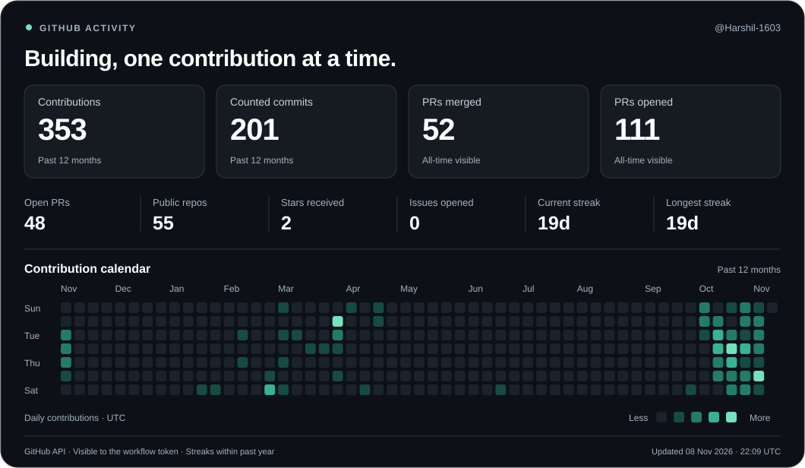

  <picture>
    <source media="(prefers-reduced-motion: reduce)" srcset="./assets/hero.svg?v=2" />
    
  </picture>

  <strong>Computer Science undergraduate at IIT Jodhpur · B.Tech 2024–2028</strong> 
  Building full-stack products, distributed systems, and performance-focused software. 
  Interested in databases, operating systems, algorithms, reinforcement learning, and open source.

  <a href="#about-me">About</a> &nbsp;·&nbsp;
  <a href="#tech-stack">Tech stack</a> &nbsp;·&nbsp;
  <a href="#github-activity">Activity</a> &nbsp;·&nbsp;
  <a href="#featured-projects">Projects</a> &nbsp;·&nbsp;
  <a href="#open-source-contributions">Open source</a> &nbsp;·&nbsp;
  <a href="https://github.com/Harshil-1603?tab=repositories">All repositories</a>

## About me

- **Education:** B.Tech in Computer Science and Engineering, IIT Jodhpur (2024–2028).
- **What I build:** full-stack applications, resource-booking platforms, distributed storage systems, and algorithmic tools.
- **Systems interests:** operating systems, database internals, consistency and replication, performance engineering, and computer architecture.
- **Exploring:** reinforcement learning for systems optimization, FPGA-based low-latency computing, and local AI tooling.
- **Open source:** contributing focused fixes and regression coverage to projects across Go, Python, and JavaScript ecosystems.

## Tech stack

  <strong>Languages</strong>  
  

  <strong>Web &amp; data</strong>  
  

  <strong>Daily drivers</strong>  
  

## GitHub activity

  

  Based on GitHub's contribution calendar, automatically refreshed every six hours via <a href="./.github/workflows/contribution-dashboard.yml">GitHub Actions</a>. Streaks are calculated using UTC dates; longest streak covers the displayed past year. <a href="https://github.com/Harshil-1603?tab=overview">View official activity</a>.

## Featured projects

<table>
  <tr>
    <td width="50%" valign="top">
      <h3><a href="https://github.com/Harshil-1603/Campus-Grid">Campus Grid ↗</a></h3>
      
A shared-resource booking platform for campuses: room calendars, approval workflows, role-based access, and automatic waitlists.

      
<code>TypeScript</code> <code>Next.js</code> <code>PostgreSQL</code> <code>Prisma</code>

    </td>
    <td width="50%" valign="top">
      <h3><a href="https://github.com/Harshil-1603/DSA-project">Test Centre Allotment ↗</a></h3>
      
Student-to-centre allocation on real road networks, with Dijkstra, A* pathfinding, spatial indexing, and interactive maps.

      
<code>C++17</code> <code>OpenStreetMap</code> <code>Leaflet</code> <code>CMake</code>

    </td>
  </tr>
</table>

**Also built:** [Face Recognition Attendance](https://github.com/Harshil-1603/face_recognition) — a Python web app that marks attendance with face recognition and syncs records to Google Sheets.

### More things I've worked on

| Project | Engineering focus |
| :--- | :--- |
| **Minitrue / Minytu** · Distributed time-series database | Go, gRPC, consistent hashing, gossip, quorum reads, write-ahead logging, replication, and Gorilla-style compression. |
| **Destyn** · Campus social application | Next.js, TypeScript, MongoDB, real-time communication, authentication, and privacy-focused features. |
| **ChampSim branch prediction** | Comparing bimodal counter-table sizes and perceptron baselines using CPU traces. |
| **Adaptive query optimization with RL** | Exploring reinforcement learning for choosing database query execution strategies. |

These are selected engineering explorations and projects; not all have public repositories.

## Open-source contributions

I contribute fixes upstream: reproduce the issue, isolate the cause, and add regression coverage where appropriate. Selected merged pull requests:

| Project | Contribution |
| :--- | :--- |
| **[miniredis](https://github.com/alicebob/miniredis/pull/482)** · Go | Keep copied streams and consumer groups independent. |
| **[LNbits](https://github.com/lnbits/lnbits/pull/4262)** · Python | Preserve fractional seconds in SQLite date filters. |
| **[OpenFeature Go SDK](https://github.com/open-feature/go-sdk/pull/624)** · Go | Validate feature-flag metadata types in telemetry. |
| **[pydot](https://github.com/pydot/pydot/pull/596)** · Python | Render DOT graphs as SVG directly in notebook cells. |
| **[freeCodeCamp](https://github.com/freeCodeCamp/freeCodeCamp/pull/70646)** · Curriculum | Clarify the Python RPG character lab instructions. |

[Browse my merged contributions ↗](https://github.com/search?q=author%3AHarshil-1603+is%3Apr+is%3Amerged+-user%3AHarshil-1603&type=pullrequests)

---

<strong>Good problems make good conversations.</strong> 
Explore a project, inspect the implementation, or discuss systems, databases, and open-source engineering.

  

