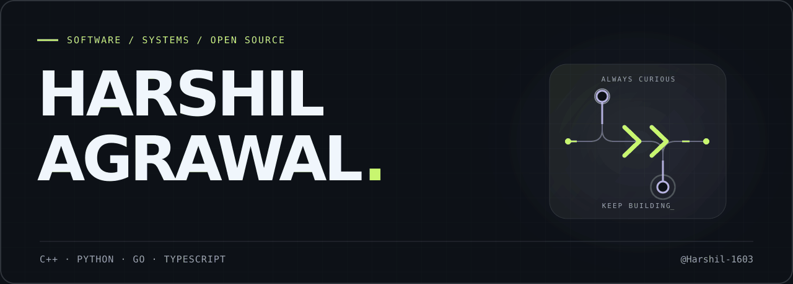

  <picture>
    <source media="(prefers-reduced-motion: reduce)" srcset="./assets/hero.svg?v=2" />
    
  </picture>

  <strong>I build useful software and dig into the details that make it work.</strong> 
  Full-stack applications, graph algorithms, and fixes that find their way upstream.

  <a href="#tech-stack">Tech stack</a> &nbsp;·&nbsp;
  <a href="#github-activity">GitHub stats</a> &nbsp;·&nbsp;
  <a href="#selected-work">Projects</a> &nbsp;·&nbsp;
  <a href="#open-source">Open source</a> &nbsp;·&nbsp;
  <a href="https://github.com/Harshil-1603?tab=repositories">All repositories</a>

## Tech stack

  <strong>Languages</strong>  
  

  <strong>Web &amp; data</strong>  
  

  <strong>Daily drivers</strong>  
  

## GitHub activity

  
  

  

## Selected work

<table>
  <tr>
    <td width="50%" valign="top">
      <h3><a href="https://github.com/Harshil-1603/Campus-Grid">Campus Grid ↗</a></h3>
      
A shared-resource booking platform for campuses: room calendars, approval workflows, role-based access, and automatic waitlists.

      
<code>TypeScript</code> <code>Next.js</code> <code>PostgreSQL</code> <code>Prisma</code>

    </td>
    <td width="50%" valign="top">
      <h3><a href="https://github.com/Harshil-1603/DSA-project">Test Centre Allotment ↗</a></h3>
      
Student-to-centre allocation on real road networks, with Dijkstra, A* pathfinding, spatial indexing, and interactive maps.

      
<code>C++17</code> <code>OpenStreetMap</code> <code>Leaflet</code> <code>CMake</code>

    </td>
  </tr>
</table>

**Also built:** [Face Recognition Attendance](https://github.com/Harshil-1603/face_recognition) — a Python web app that marks attendance with face recognition and syncs records to Google Sheets.

## Open source

I like the work behind a good fix: reproduce the edge case, understand the cause, and add a regression test. A few contributions merged upstream:

| Project | Contribution |
| :--- | :--- |
| **[miniredis](https://github.com/alicebob/miniredis/pull/482)** · Go | Keep copied streams and consumer groups independent. |
| **[LNbits](https://github.com/lnbits/lnbits/pull/4262)** · Python | Preserve fractional seconds in SQLite date filters. |
| **[OpenFeature Go SDK](https://github.com/open-feature/go-sdk/pull/624)** · Go | Validate feature-flag metadata types in telemetry. |
| **[pydot](https://github.com/pydot/pydot/pull/596)** · Python | Render DOT graphs as SVG directly in notebook cells. |
| **[freeCodeCamp](https://github.com/freeCodeCamp/freeCodeCamp/pull/70646)** · Curriculum | Clarify the Python RPG character lab instructions. |

[Browse my merged contributions ↗](https://github.com/search?q=author%3AHarshil-1603+is%3Apr+is%3Amerged+-user%3AHarshil-1603&type=pullrequests)

---

<strong>Good problems make good conversations.</strong> 
Explore a project, read a diff, or open an issue in the relevant repository.

  

