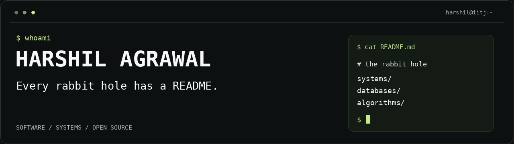

  <picture>
    <source media="(prefers-reduced-motion: reduce)" srcset="./assets/hero-terminal.svg" />
    
  </picture>

  <strong>Computer Science @ IIT Jodhpur · B.Tech 2024–2028</strong> 
  Exploring systems, databases, and the details that make software work.

  <a href="#about-me">About</a> &nbsp;·&nbsp;
  <a href="#tech-stack">Tech stack</a> &nbsp;·&nbsp;
  <a href="#github-activity">Activity</a> &nbsp;·&nbsp;
  <a href="https://github.com/Harshil-1603?tab=repositories">All repositories</a>

## About me

- **Education:** B.Tech in Computer Science and Engineering, IIT Jodhpur (2024–2028).
- **What I build:** full-stack applications, resource-booking platforms, distributed storage systems, and algorithmic tools.
- **Systems interests:** operating systems, database internals, consistency and replication, performance engineering, and computer architecture.
- **Exploring:** reinforcement learning for systems optimization, FPGA-based low-latency computing, and local AI tooling.
- **Open source:** contributing focused fixes and regression coverage to projects across Go, Python, and JavaScript ecosystems.

## Tech stack

  <strong>Languages</strong>  
  

  <strong>Frontend &amp; mobile</strong>  
  

  <strong>Backend &amp; databases</strong>  
  
   Socket.IO · WebSockets · SQLModel

  <strong>Machine learning &amp; data</strong>  
  
   NumPy · pandas · SciPy · Matplotlib · Transformers · Streamlit

  <strong>Tools &amp; systems</strong>  
  

## GitHub activity

  

  GitHub API data · <a href="./.github/workflows/contribution-dashboard.yml">automatic refresh every six hours</a> · <a href="https://github.com/Harshil-1603?tab=overview">official contribution history</a>

  
How these statistics are counted

  
PRs, merged PRs, open PRs, and issues come from GitHub search for the account's authorship; public repositories and received stars come from the account's public repository list. Contributions and counted commits use GitHub's official rolling-year contribution calendar; streaks are calculated from its daily totals (UTC). Private contributions depend on the permissions of the workflow token. These figures refresh every six hours, not on every profile visit.

